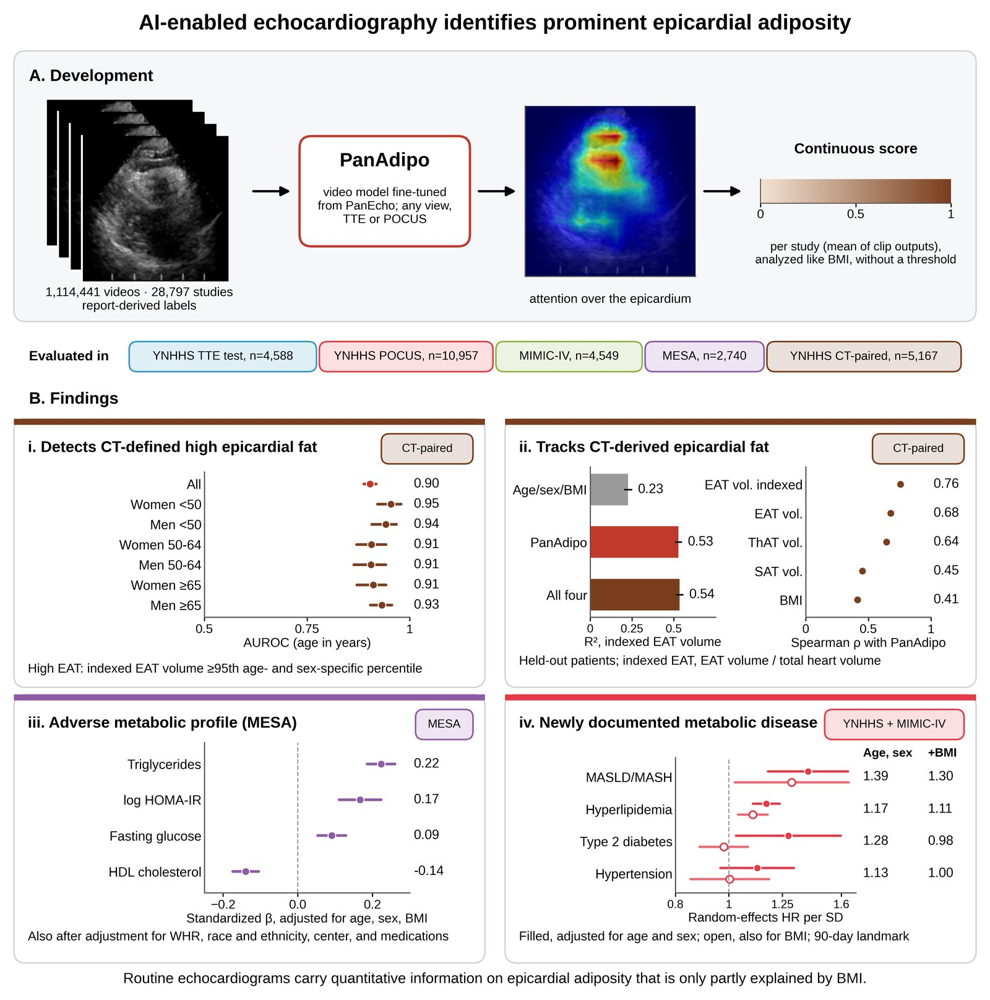
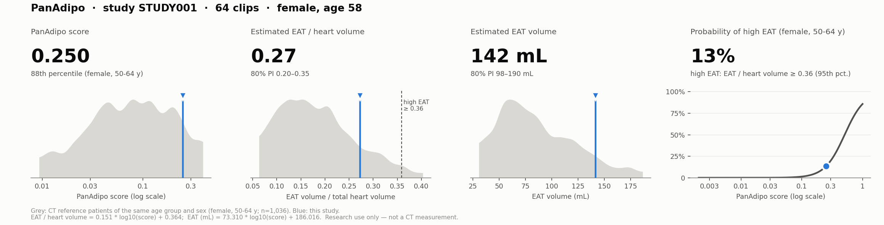
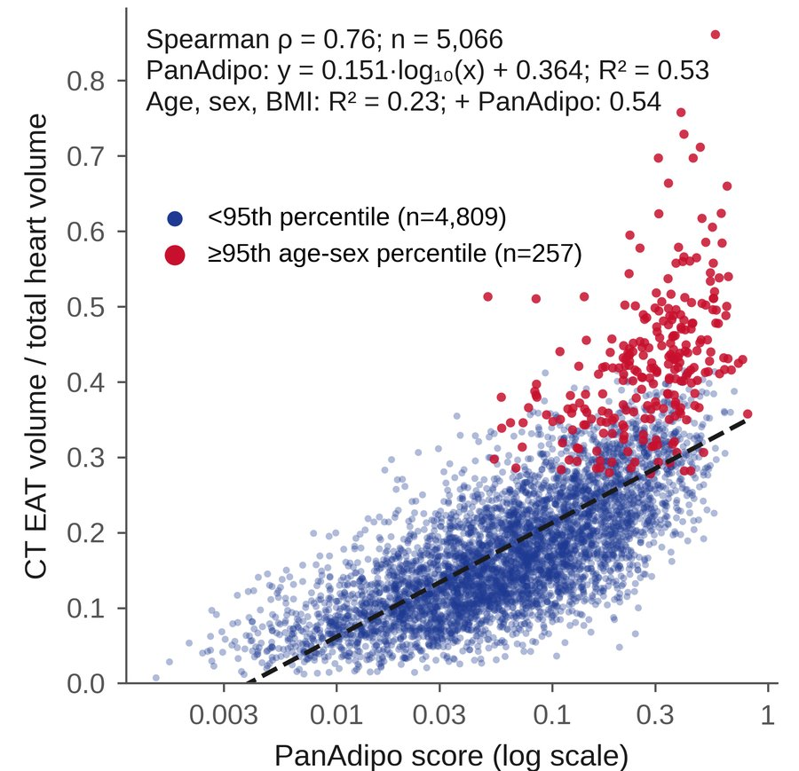
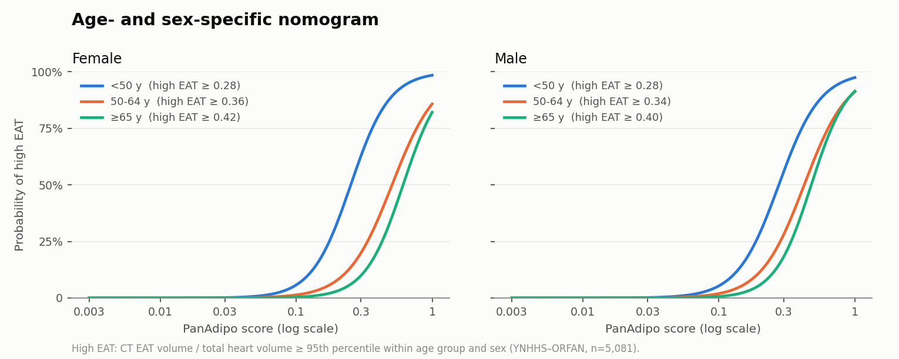
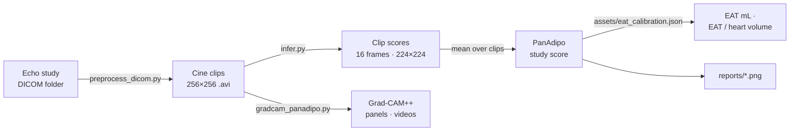
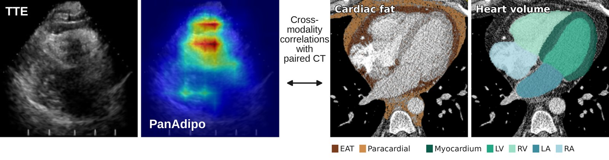

<h1 align="center">PanAdipo</h1>
<p align="center"><b>Epicardial adiposity from any routine echocardiogram</b><br>
Echo DICOM study ➜ PanAdipo score ➜ CT-calibrated EAT volume (mL) and EAT / heart volume</p>

<p align="center">


</p>

<p align="center"></p>

PanAdipo is a video model fine-tuned from the [PanEcho](https://github.com/CarDS-Yale/PanEcho) echocardiography
foundation model. It scores **prominent epicardial adiposity** from any standard 2D B-mode clip (any view,
TTE or POCUS) and averages the clip scores into a single score per study. In 5,081 patients with a CCTA
within a year of the echo, the score tracked CT-measured epicardial adipose tissue (EAT): **Spearman ρ = 0.76**
with EAT indexed to heart volume, **AUROC 0.90** for age- and sex-specific high EAT. This repository holds the
end-to-end inference code: DICOM preprocessing, the model, the CT-calibrated EAT estimate, and Grad-CAM++.

---

## Quick start: one echo study, one command

```bash
conda env create -f envs/panadipo.yml && conda activate panadipo
./copy_weights.sh                       # downloads weights/best_model.pt from the v1.0 release

python run_pipeline.py --study_dir /path/to/STUDY001 --out_dir results/
python run_pipeline.py --study_dir /path/to/STUDY001 --out_dir results/ --age 58 --sex F   # override age / sex
```

Age and sex are read from the DICOM header (`PatientAge` / `PatientBirthDate`, `PatientSex`) when present.
`--age/--sex` or `--demographics` (a CSV with `study_id,age,sex`) override them. With age and sex, the
outputs also include the **age- and sex-specific nomogram** (see below).

```
# illustrative output (synthetic study, score = 0.25, female, 58 y)
── 1/3  DICOM -> AVI
92 DICOMs from 1 studies -> results
  video: 57, still: 33, pixel_failed: 2
  age / sex from DICOM header: 1/1 studies
── 2/3  PanAdipo inference
57 clips from 1 studies | device=cuda
  age-sex nomogram applied to 1/1 studies
── 3/3  Reports

 study_id  n_clips  panadipo_score  score_percentile  eat_volume_ml  eat_index  p_high_eat    age     sex  age_sex_group  high_eat_threshold  p_high_eat_age_sex  score_percentile_age_sex
 STUDY001       57           0.250            88.815        141.879      0.273       0.164  58.000  female   female 50-64               0.359               0.134                    88.333
```

Each study also gets a one-page report, `results/reports/<study_id>.png`:

<p align="center"><br>
<sub>Example report (synthetic study: score 0.25, female, 58 y). Grey: CT reference patients of the same age group and sex. Blue: this study.</sub></p>

For many studies, point it at a folder of study folders (`--studies_root`) or at a manifest CSV
(`--manifest`, columns `study_id,local_path`). A GPU is recommended; CPU works but is slow.

---

## What you get

| Output | Meaning |
|---|---|
| `panadipo_score` | Mean PanAdipo probability over all cine clips in the study (manuscript definition). A continuous score (0–1), **not a calibrated probability**: training used a positive-class weight. |
| `score_percentile` | Percentile of the score in the CT reference cohort (n = 5,081). |
| `eat_index` (+ `_pi80_*`, `_pi95_*`) | Estimated **CT EAT volume / total heart volume**, with 80% / 95% prediction intervals. |
| `eat_volume_ml` (+ PIs) | Estimated **CT EAT volume in mL**. |
| `p_high_eat` | Rate of high EAT among reference patients with a similar score (all ages and sexes pooled). |
| `age_sex_group`, `high_eat_threshold` | Age group (<50, 50–64, ≥65 y) × sex, and that group's high-EAT cutoff (95th percentile of EAT / heart volume). |
| `p_high_eat_age_sex` | **Age- and sex-specific probability of high EAT**, from the nomogram. |
| `score_percentile_age_sex` | Percentile of the score among reference patients of the same age group and sex. |
| `clip_predictions.csv` | Score for every clip, if you want to filter by view yourself. |

### How EAT is estimated



The score is mapped to CT EAT with the log-linear fit from the manuscript (Figure 3A). The fit used YNHHS
patients held out from model development who had a CCTA within 365 days of the echo (ORFAN cohort, one pair
per patient). EAT was segmented with Body & Organ Analysis (BOA) as fat between −190 and −30 HU inside the
pericardium.

```
EAT / heart volume = 0.151 · log10(score) + 0.364      R² = 0.53
EAT volume (mL)    = 73.3  · log10(score) + 186.0      R² = 0.44
```

Heart volume is the sum of the LV myocardium, LV, RV, LA, and RA. Prediction intervals are the empirical
residual quantiles. Patient-grouped 5-fold cross-validation:

| Target | CV R² | CV MAE | 80% PI coverage | 95% PI coverage |
|---|---|---|---|---|
| EAT / heart volume | 0.53 | 0.050 | 80.0% | 94.9% |
| EAT volume (mL) | 0.44 | 29 mL | 80.0% | 95.0% |

Only the coefficients and aggregate summaries ship, in [`assets/eat_calibration.json`](assets/eat_calibration.json).
No patient-level data is included. These are **population-level estimates for research**. They are not a
substitute for CT, and they were derived in one health system on a mostly Philips fleet.

<br clear="right">

### Age- and sex-specific nomogram

<p align="center"></p>

Following the paper, **high EAT** is CT EAT volume / total heart volume at or above the 95th percentile for
the patient's age group (<50, 50–64, ≥65 years) and sex. For each of the six groups, a logistic model of
log10(PanAdipo score) gives the probability of high EAT. PanAdipo discriminated high EAT with an AUROC of
0.91–0.95 across the groups. The same score means more for a younger patient: the reference distribution and
the high-EAT cutoff both shift with age.

---

## Pipeline



Each step also runs on its own:

```bash
# 1. DICOM -> AVI   (stills and <16-frame objects are skipped; inputs are only read)
python preprocess_dicom.py --studies_root /data/echo_dicoms --out_dir work/ --n_workers 16

# 2. AVI -> clip + study scores (+ EAT estimates)
python infer.py --videos_csv work/videos.csv --out_dir work/
python infer.py --video_dir  my_avis/       --out_dir out/     # files named <study_id>_<clip>.avi
python infer.py --videos a.avi b.avi        --out_dir out/

# 3. Grad-CAM++ explainability (manuscript settings are the defaults)
python gradcam_panadipo.py --fpaths work/videos/STUDY001_12.avi --out_dir gradcam_out/
```

<p align="center"><br>
<sub>Grad-CAM++ attention over the epicardium (left) and the paired CCTA reference standard (right): BOA segmentation of epicardial and paracardial fat and of the cardiac structures summed as heart volume.</sub></p>

**Preprocessing** is a local-file port of the PanEcho pipeline. A motion mask built from frame-to-frame
changes keeps only the ultrasound sector and drops burned-in text, ECG traces, and calipers. Frames are cropped
to the mask, resized to 224 px with `INTER_AREA`, and zero-padded to 256 × 256. Clips are named
`<study_id>_<dicom_stem>.avi`. It needs **pydicom ≥ 3**, which converts YBR-encoded JPEG frames to RGB.

**Inference** samples 16 evenly spaced frames, resizes them to 224 × 224 with `INTER_AREA`, and applies
ImageNet normalisation, exactly as in the manuscript evaluation. The **Grad-CAM++** script uses the per-frame
ConvNeXt encoder (penultimate stage) with unsharp-mask sharpening and a 0.25 threshold. It writes a
cardiac-cycle panel PNG plus overlay and side-by-side MP4s.

---

## Model weights

| | |
|---|---|
| File | `weights/best_model.pt` (≈ 170 MB; model weights only, no optimizer state or training logs) |
| Version | v1.0 (manuscript model) |
| MD5 | `1aa0ce1989506553dca91f3982a199cf` |
| Architecture | PanEcho backbone (ConvNeXt-T per frame → 4-layer temporal Transformer → 768-d) + Dropout(0.3) → Linear |
| Input | 16 frames × 224 × 224 RGB, ImageNet normalisation |

Weights are not stored in git. They are published as a release asset (`v1.0`), and `copy_weights.sh` fetches them:

```bash
./copy_weights.sh                          # download from the release (uses gh, or GH_TOKEN for a private repo)
./copy_weights.sh /path/to/best_model.pt   # or copy a local file
md5sum weights/best_model.pt               # expect 1aa0ce1989506553dca91f3982a199cf
```

The script also prints a sanity check (head type, clip_len, MD5). On first run, `torch.hub` downloads the PanEcho architecture
code (not its weights) from GitHub. That step needs internet once and is then cached in `~/.cache/torch/hub`.

## Repository layout

```
run_pipeline.py          DICOM study -> score -> EAT -> report         (one command)
preprocess_dicom.py      step 1: DICOM -> 256x256 AVI
infer.py                 step 2: AVI -> clip/study scores + EAT estimates
gradcam_panadipo.py      Grad-CAM++ panels and videos
copy_weights.sh          download / stage weights/best_model.pt
panadipo/
  model.py               PanEcho backbone + head, checkpoint loading
  video.py               clip loading (identical to the manuscript evaluation)
  dicom.py               motion-mask crop / resize / AVI writing
  eat.py                 CT-calibrated EAT estimates + age-sex nomogram
  report.py              per-study PNG report
assets/eat_calibration.json   formula coefficients, nomogram coefficients, aggregate reference quantiles
envs/panadipo.yml        single environment for everything
docs/figures/            README figures (from the manuscript)
```

## Intended use and limitations

- **Research use only.** PanAdipo is not a medical device and has not been prospectively validated.
- The training label was a report-derived "prominent epicardial fat depot" (weak supervision). The score is
  continuous and has no diagnostic threshold.
- EAT estimates carry wide individual prediction intervals (R² ≈ 0.5). Use them to rank or stratify cohorts, not
  to replace CT measurement in an individual patient.
- Developed at Yale-New Haven Health. Performance on other vendors, sites, and paediatric studies has not been
  established.

## License

**Academic and non-commercial use only. Commercial use is not permitted.**

- **Code**: [PolyForm Noncommercial License 1.0.0](LICENSE). Use for research, teaching, and other
  non-commercial purposes by individuals and by academic, non-profit, and government institutions.
- **Model weights** (`best_model.pt` release asset): [CC BY-NC-SA 4.0](WEIGHTS_LICENSE.md), which follows the
  upstream PanEcho weights.

Copyright © 2026 Yale University. For commercial licensing, or to tell us how you are using PanAdipo, contact
**evangelos.oikonomou@yale.edu**.

## Citation

If you use PanAdipo, please cite:

> Aminorroaya A, …, Oikonomou EK\*. PanAdipo: AI-enabled echocardiography identifies prominent epicardial
> adiposity. *Under review*, 2026.
>
> \*Corresponding author: Evangelos K. Oikonomou, MD, DPhil (evangelos.oikonomou@yale.edu)

PanAdipo is built on the [PanEcho](https://github.com/CarDS-Yale/PanEcho) echocardiography foundation model:
PMID: 40549400.

## Contact

Questions, bug reports, and collaboration requests: open a GitHub issue or email **evangelos.oikonomou@yale.edu**.
