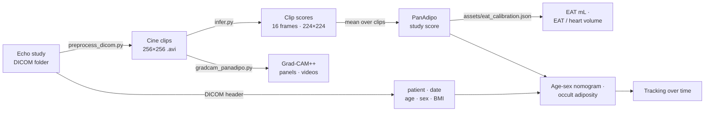

<h1 align="center">PanAdipo</h1>
<p align="center"><b>Epicardial adiposity from any routine echocardiogram</b><br>
Echo DICOM study ➜ PanAdipo score ➜ CT-calibrated EAT ➜ age-sex nomogram ➜ occult adiposity ➜ tracking over time</p>

<p align="center">


</p>

<p align="center"></p>

PanAdipo is a video model fine-tuned from an echocardiography foundation model. It scores **prominent epicardial adiposity** from any standard 2D B-mode clip (any view,
TTE or POCUS) and averages the clip scores into one score per study. In 5,081 patients with a CCTA within a
year of the echo, the score tracked CT-measured epicardial adipose tissue (EAT): **Spearman ρ = 0.76** with EAT
indexed to heart volume, and **AUROC 0.90** (0.91–0.95 across age-sex groups) for age- and sex-specific high EAT.

This repository runs the whole workflow on your own machine: DICOM preprocessing, the model, CT-calibrated EAT
estimates, the age-sex nomogram, occult-adiposity flags, serial tracking, Grad-CAM++, a local app, and an
online nomogram viewer.

---

## Quick start

```bash
git clone https://github.com/Cardiometabolic-Intelligence/PanAdipo.git && cd PanAdipo
conda env create -f envs/panadipo.yml && conda activate panadipo
./copy_weights.sh                       # downloads weights/best_model.pt from the v1.0 release

python run_pipeline.py --studies_root /path/to/echo_dicoms --out_dir results/   # one sub-folder per study
python app.py                                                                   # or: the local app (below)
```

Patient ID, study date, age, sex and BMI are read from each study's DICOM header (`PatientID`, `StudyDate`,
`PatientAge` / `PatientBirthDate`, `PatientSex`, `PatientWeight` / `PatientSize`). All are optional, and you can
override them with `--age 58 --sex F --bmi 27` or with `--demographics my_table.csv`
(`study_id` plus any of `patient_id, study_date, age, sex, bmi`).

```
# illustrative output (synthetic studies)
── 1/3  DICOM -> AVI
  DICOM header (2 studies): age 1, sex 2, bmi 1, patient_id 2, study_date 2
── 2/3  PanAdipo inference
119 clips from 2 studies | device=cuda
  age-sex nomogram: 1/2 studies | occult-adiposity flag (needs BMI): 1/2 studies

  ! Missing study information
    no age/sex -> pooled estimates only, no nomogram: STUDY002
    no BMI     -> no occult-adiposity flag:           STUDY002
    Fill in results/missing_demographics.csv, then re-apply (no re-inference needed):
      python infer.py --study_predictions results/study_predictions.csv --demographics results/missing_demographics.csv --out_dir results
── 3/3  Reports

study_id  n_clips  panadipo_score  eat_volume_ml  eat_index    age    sex    bmi age_sex_group  p_high_eat_age_sex                           eat_flag
STUDY001       57           0.250        141.879      0.273 58.000 female 26.000  female 50-64               0.134 screen-positive · occult (BMI <30)
STUDY002       62           0.060         96.442      0.179    NaN   male    NaN           NaN                 NaN                age/sex unavailable
```

Missing age, sex or BMI never blocks a run. Those studies still get EAT estimates from the pooled reference,
are listed by name, and are written to `missing_demographics.csv`. Fill it in, re-apply with the printed command
(the model is not re-run), and the nomogram and occult flag are added.

Each study gets a one-page report, `results/reports/<study_id>.png`:

<p align="center"><br>
<sub>Example report (synthetic study: score 0.25, female, 58 y, BMI 26). Grey: CT reference patients of the same age group and sex. Blue: this study. Right: the nomogram curve with the published age-sex threshold (dashed).</sub></p>

---

## Interactive tools

### Local app: `python app.py`

A browser interface that runs entirely on your computer (it binds to `127.0.0.1`; nothing is uploaded).

1. **Load & run**: point it at a folder of studies (or upload a `.zip`). Review and edit patient ID, date, age,
   sex and BMI, then run PanAdipo. You get scores, EAT estimates, nomogram, occult-adiposity summary, reports
   and a CSV.
2. **Track over time**: serial studies per patient, with the threshold moving as the patient changes age group.
   Add earlier `study_predictions.csv` files to follow patients across runs.
3. **Nomogram calculator**: score + age + sex (+ BMI). No images needed.

Use `python app.py --demo` to start with a synthetic patient loaded.

### Online viewer: `docs/index.html` (GitHub Pages)

A static page with the **nomogram calculator** and a **results tracker**. Open a `study_predictions.csv` and your
browser computes the estimates, screening flags and patient trajectories locally; the file is never uploaded.
It cannot run the model (that needs Python and ideally a GPU), so it works on the scores the pipeline produces.
Add `?demo=1` to the URL to load a synthetic example. To run it offline, use `python -m http.server` in `docs/`.

---

## What you get

| Output | Meaning |
|---|---|
| `panadipo_score` | Mean PanAdipo probability over all cine clips in the study (manuscript definition). A continuous score (0–1), **not a calibrated probability**: training used a positive-class weight. |
| `eat_index` (+ `_pi80_*`, `_pi95_*`) | Estimated **CT EAT volume / total heart volume**, with 80% / 95% prediction intervals. |
| `eat_volume_ml` (+ PIs) | Estimated **CT EAT volume in mL**. |
| `score_percentile`, `p_high_eat` | Percentile of the score, and the rate of high EAT at a similar score, in the pooled CT reference (n = 5,081). |
| `age_sex_group`, `high_eat_threshold` | Age group (<50, 50–64, ≥65 y) × sex, and that group's high-EAT cutoff (95th percentile of EAT / heart volume). |
| `p_high_eat_age_sex`, `score_percentile_age_sex` | **Age- and sex-specific probability of high EAT** (nomogram) and percentile of the score within the group. |
| `score_threshold_age_sex`, `above_score_threshold` | The published age-sex PanAdipo threshold for high EAT (Supplemental Table 6) and whether the study is at or above it. |
| `occult_adiposity`, `eat_flag` | **Occult adiposity**: screen-positive in a patient without obesity (BMI < 30). `eat_flag` summarises: screen-negative / screen-positive · occult / screen-positive · with obesity / BMI or age-sex unavailable. |
| `patient_id`, `study_date`, `age`, `sex`, `bmi` | Study information used, with `age_sex_source` and `bmi_source` (command line / csv / dicom / missing). |
| `clip_predictions.csv` | Score for every clip, if you want to filter by view yourself. |

### How EAT is estimated


The score is mapped to CT EAT with the log-linear fit from the manuscript (Figure 3A). The fit used YNHHS
patients held out from model development who had a CCTA within 365 days of the echo (ORFAN cohort, one pair
per patient). EAT was segmented with Body & Organ Analysis (BOA) as fat between −190 and −30 HU inside the
pericardium.

```
EAT / heart volume = 0.151 · log10(score) + 0.364      R² = 0.53
EAT volume (mL)    = 73.3  · log10(score) + 186.0      R² = 0.44
```

Heart volume is the sum of the LV myocardium, LV, RV, LA, and RA. Prediction intervals are the empirical
residual quantiles. In patient-grouped 5-fold cross-validation, the 80% and 95% intervals covered 80% and 95%
of patients.

Only coefficients and aggregate summaries ship, in [`assets/eat_calibration.json`](assets/eat_calibration.json).
No patient-level data is included. These are **population-level estimates for research**. They are not a
substitute for CT, and they were derived in one health system on a mostly Philips fleet.

<br clear="right">

### Age- and sex-specific nomogram and occult adiposity

<p align="center"></p>

Following the paper, **high EAT** is CT EAT volume / total heart volume at or above the 95th percentile for
the patient's age group (<50, 50–64, ≥65 years) and sex. For each group, a logistic model of log10(PanAdipo
score) gives the probability of high EAT. The **age-sex thresholds** are the PanAdipo cut-offs from
Supplemental Table 6:

| Group | Score threshold | AUROC | Sens. | Spec. | PPV | NPV |
|---|---|---|---|---|---|---|
| Female, <50 y | 0.094 | 0.95 | 93% | 87% | 28% | 100% |
| Male, <50 y | 0.120 | 0.94 | 89% | 90% | 31% | 99% |
| Female, 50–64 y | 0.213 | 0.91 | 81% | 87% | 25% | 99% |
| Male, 50–64 y | 0.118 | 0.91 | 92% | 75% | 16% | 99% |
| Female, ≥65 y | 0.295 | 0.91 | 83% | 87% | 25% | 99% |
| Male, ≥65 y | 0.219 | 0.93 | 92% | 86% | 26% | 100% |

A study at or above its threshold is **screen-positive for high EAT**. With a BMI below 30 kg/m², it is also
flagged as **occult adiposity**: likely excess epicardial fat that BMI alone would not raise suspicion of. The
thresholds favour sensitivity. At about 5% prevalence a positive screen has a PPV of 16–31%, so it calls for
attention, not a diagnosis.

---

## Pipeline



Each step also runs on its own:

```bash
# 1. DICOM -> AVI   (stills and <16-frame objects are skipped; inputs are only read)
python preprocess_dicom.py --studies_root /data/echo_dicoms --out_dir work/ --n_workers 16

# 2. AVI -> clip + study scores, EAT estimates, nomogram
python infer.py --videos_csv work/videos.csv --out_dir work/ --demographics my_table.csv
python infer.py --video_dir  my_avis/       --out_dir out/ --age 58 --sex F --bmi 27   # files named <study_id>_<clip>.avi

# 2b. Re-apply estimates with new age / sex / BMI (no model run)
python infer.py --study_predictions work/study_predictions.csv --demographics filled.csv --out_dir work/

# 3. Grad-CAM++ explainability (manuscript settings are the defaults)
python gradcam_panadipo.py --fpaths work/videos/STUDY001_12.avi --out_dir gradcam_out/
```

<p align="center"><br>
<sub>Grad-CAM++ attention over the epicardium (left) and the paired CCTA reference standard (right): BOA segmentation of epicardial and paracardial fat and of the cardiac structures summed as heart volume.</sub></p>

**Preprocessing** follows the original pipeline. A motion mask built from frame-to-frame
changes keeps only the ultrasound sector and drops burned-in text, ECG traces, and calipers. Frames are cropped
to the mask, resized to 224 px with `INTER_AREA`, and zero-padded to 256 × 256. Clips are named
`<study_id>_<dicom_stem>.avi`. It needs **pydicom ≥ 3**, which converts YBR-encoded JPEG frames to RGB.

**Inference** samples 16 evenly spaced frames, resizes them to 224 × 224 with `INTER_AREA`, and applies
ImageNet normalisation, as in the manuscript evaluation. The **Grad-CAM++** script uses the per-frame ConvNeXt
encoder (penultimate stage) with unsharp-mask sharpening and a 0.25 threshold. It writes a cardiac-cycle panel
PNG plus overlay and side-by-side MP4s.

---

## Model weights

| | |
|---|---|
| File | `weights/best_model.pt` (≈ 170 MB; model weights only, no optimizer state or training logs) |
| Version | v1.0 (manuscript model) |
| MD5 | `1aa0ce1989506553dca91f3982a199cf` |
| Architecture | Video backbone (ConvNeXt-T per frame → 4-layer temporal Transformer → 768-d) + Dropout(0.3) → Linear |
| Input | 16 frames × 224 × 224 RGB, ImageNet normalisation |

Weights are not stored in git. They are published as a release asset (`v1.0`), and `copy_weights.sh` fetches them:

```bash
./copy_weights.sh                          # download from the release (uses gh, or GH_TOKEN for a private repo)
./copy_weights.sh /path/to/best_model.pt   # or copy a local file
md5sum weights/best_model.pt               # expect 1aa0ce1989506553dca91f3982a199cf
```

The checkpoint is loaded with PyTorch's safe `weights_only` mode. On first run, `torch.hub` downloads the
backbone architecture code (not its weights) from GitHub; that needs internet once and is then cached.

## Repository layout

```
run_pipeline.py          DICOM studies -> score -> EAT -> nomogram -> reports   (one command)
app.py                   local browser app: load, run, nomogram, track over time
preprocess_dicom.py      step 1: DICOM -> 256x256 AVI
infer.py                 step 2: AVI -> clip/study scores + EAT estimates + nomogram (or re-apply to a CSV)
gradcam_panadipo.py      Grad-CAM++ panels and videos
copy_weights.sh          download / stage weights/best_model.pt
panadipo/
  model.py               backbone + head, checkpoint loading
  video.py               clip loading (as in the manuscript evaluation)
  dicom.py               motion-mask crop / resize / AVI writing; DICOM header (patient, date, age, sex, BMI)
  eat.py                 CT-calibrated EAT estimates, age-sex nomogram, thresholds, occult adiposity
  longitudinal.py        per-patient trajectories
  report.py              per-study PNG report
assets/eat_calibration.json   formula, nomogram and threshold values; aggregate reference quantiles
docs/index.html          online nomogram calculator + results tracker (GitHub Pages; docs/calibration.json)
envs/panadipo.yml        single environment for everything
```

## Intended use and limitations

- **Research use only.** PanAdipo is not a medical device and has not been prospectively validated.
- The training label was a report-derived "prominent epicardial fat depot" (weak supervision). The score is
  continuous. The age-sex thresholds are screening cut-offs for CT-defined high EAT, not diagnostic criteria.
- EAT estimates carry wide individual prediction intervals (R² ≈ 0.5). Use them to rank or stratify, not to
  replace CT measurement in an individual patient.
- "Occult adiposity" is this tool's operational definition (screen-positive with BMI < 30), not a manuscript endpoint.
- Developed at Yale-New Haven Health. Performance on other vendors, sites, and paediatric studies has not been
  established.

## License

**Academic and non-commercial use only. Commercial use is not permitted.**

- **Code**: [PolyForm Noncommercial License 1.0.0](LICENSE). Use for research, teaching, and other
  non-commercial purposes by individuals and by academic, non-profit, and government institutions.
- **Model weights** (`best_model.pt` release asset): [CC BY-NC-SA 4.0](WEIGHTS_LICENSE.md).

Copyright © 2026 Yale University. For commercial licensing, or to tell us how you are using PanAdipo, contact
**evangelos.oikonomou@yale.edu**.

## Citation

If you use PanAdipo, please cite:

> Aminorroaya A, …, Oikonomou EK\*. AI-Enabled Echocardiography Identifies Prominent Epicardial Adiposity
> Associated with an Adverse Cardiometabolic Profile. *Under review*, 2026.
>
> \*Corresponding author: Evangelos K. Oikonomou, MD, DPhil (evangelos.oikonomou@yale.edu)

PanAdipo is built on PanEcho (PMID: 40549400).

## Contact

Questions, bug reports, and collaboration requests: open a GitHub issue or email **evangelos.oikonomou@yale.edu**.
